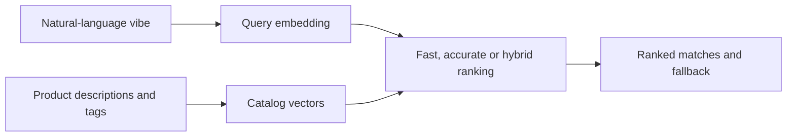

# Vibe Matcher · Fashion retrieval prototype

A notebook-based fashion recommender that compares three ways to match a natural-language mood or intent to a small, hand-authored product catalog.

[Open the notebook](nexx.ipynb) · [Original motivation and design notes](README-ORIGINAL.md)

## Three retrieval strategies

| Strategy | Ranking approach | Trade-off being explored |
|---|---|---|
| `search_fast` | Normalized description embeddings and dot products | Simple first-stage retrieval |
| `search_accurate` | Description similarity, vibe similarity and tag overlap | A richer scoring function |
| `search_hybrid` | Fast candidate filtering, then richer reranking | Candidate efficiency with reranking |

The catalog contains ten illustrative products, each with a name, description and vibe tags. Supporting utilities handle normalization, query embeddings, token overlap, low-score fallback messages and comparison plots. These are prototype design choices; the repository does not establish production-scale latency or retrieval-quality benchmarks.

## Inspect and reproduce

Open `nexx.ipynb` in Jupyter. The notebook imports NumPy, pandas, scikit-learn, matplotlib and the OpenAI Python client. The original introduction describes a dummy-embedding demo, but the checked-in implementation calls `client.embeddings.create()` and initializes the client with `os.getenv("")`.

**The current notebook therefore does not run offline as advertised and needs credential configuration before that cell can execute.** Choose deliberately between implementing a deterministic mock for a demonstration or configuring an authorized provider account for real embeddings. Do not place credentials in the notebook or its saved outputs. No API calls or credential changes were made during this repository refresh.

## Evaluation considerations

- Keep the same catalog and query set across all three methods.
- Separate query-embedding time from ranking time when comparing latency.
- Record ranking weights, candidate count, top-k and fallback threshold.
- Use labeled relevance judgments before treating “accurate” as a measured result.
- Ten authored products demonstrate mechanics; they do not establish generalization to a real catalog.

## Repository map

| File | Purpose |
|---|---|
| `nexx.ipynb` | Catalog, embeddings, retrieval methods and comparisons |
| `README-ORIGINAL.md` | Original Nexora motivation and approach |
| `docs/assets/banner.svg` | Editable repository artwork |

This is a research/prototype notebook, not a hosted shopping service. No new license or empirical performance claim is added.
